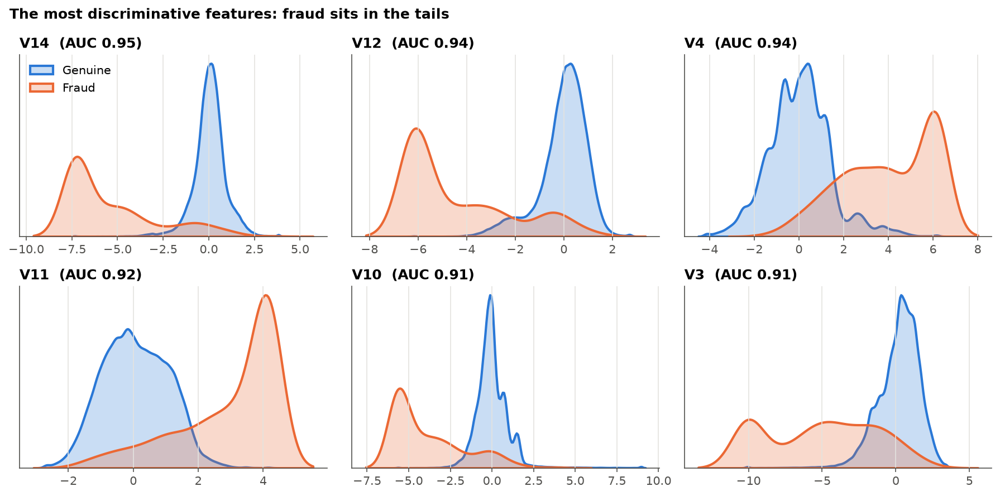
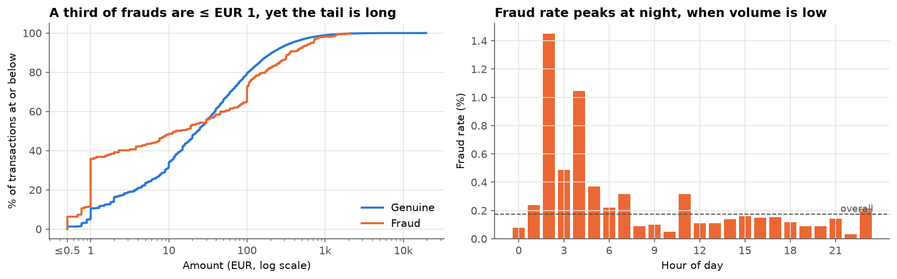
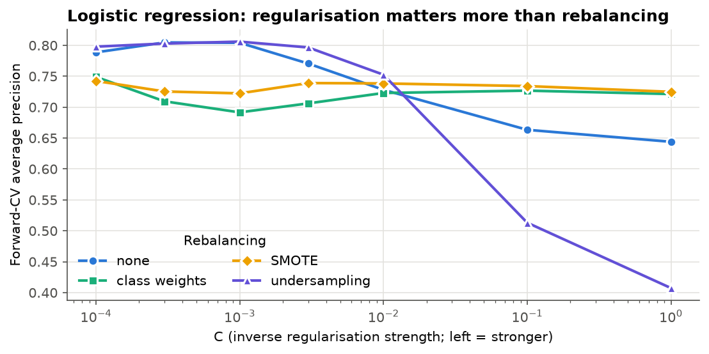
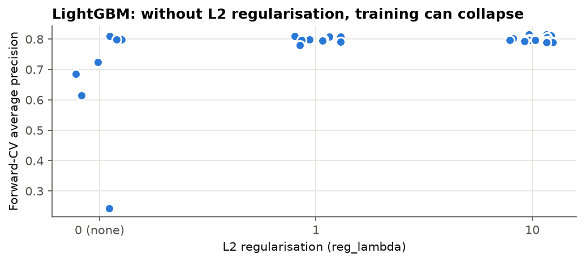
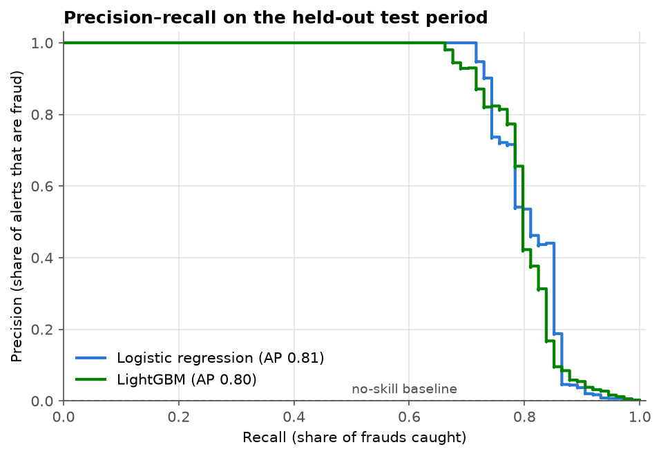
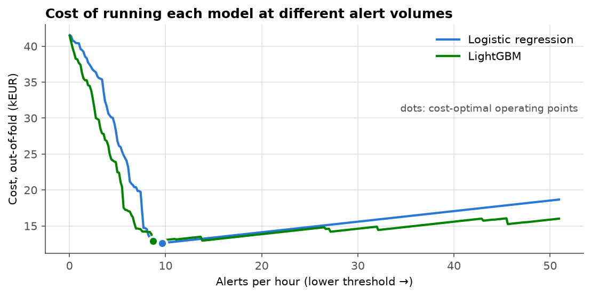
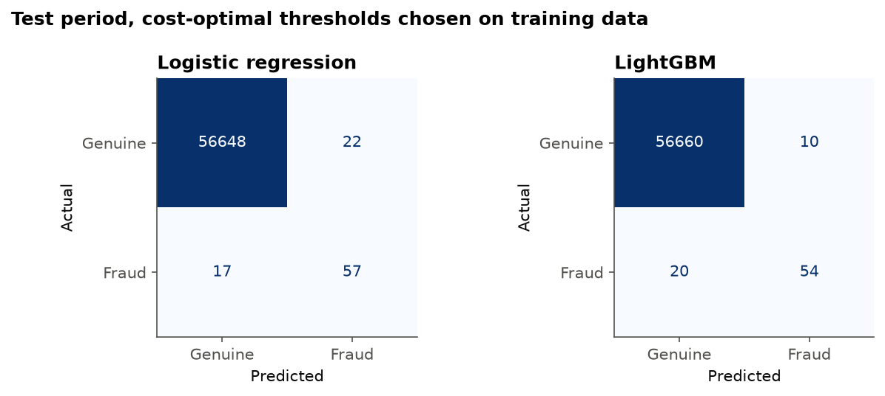
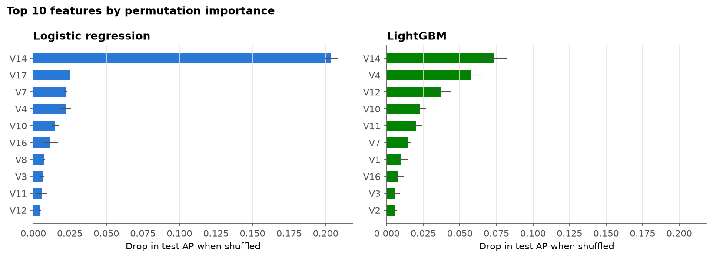

# Credit card fraud detection: results

**Bottom line.** A strongly regularised logistic regression and a tuned LightGBM both detect fraud well on a later, unseen time period. Average precision (AP) is about 0.80 for both, against a no-skill baseline of 0.0013, and the two are statistically indistinguishable. At a cost-optimal alert threshold, either model catches about three-quarters of the frauds while raising 8–10 alerts per hour. That cuts the cost of fraud by roughly 60–65% under the stated assumptions. **I recommend the logistic regression as the first production model, with LightGBM run in shadow mode as a challenger.**

The full analysis, with all code, is in [`creditcard.ipynb`](creditcard.ipynb). The presentation version is [`slides.pdf`](slides.pdf).

---

## 1. Problem and data

The goal is to score each card transaction by how likely it is to be fraudulent, so that the riskiest ones are reviewed or blocked before money is lost.

The data is the public [Kaggle credit card fraud dataset](https://www.kaggle.com/datasets/mlg-ulb/creditcardfraud): two days of transactions by European cardholders (September 2013). 28 features are anonymised PCA components (`V1`–`V28`). Only `Time` and `Amount` are in their original form.

| | |
|---|---|
| Transactions (after removing 1,081 exact duplicates) | 283,726 |
| Frauds | 473 (**0.17%**, about 1 in 600) |
| Time span | 48 hours |

The extreme imbalance rules out accuracy as a metric: predicting "never fraud" is 99.8% accurate.

## 2. How the models were evaluated

These choices were fixed before any model was trained:

- **Temporal hold-out.** Train on the first 80% of the timeline (hours 0–40, 399 frauds) and test once on the last 20% (hours 40–48, **74 frauds**). This mirrors deployment: the model is trained on the past and scores the future.
- **Forward-chaining cross-validation** (5 folds) within the training period for every modelling decision. Each fold trains on the past and validates on the next block.
- **Metric: average precision** (area under the precision–recall curve). It measures how well frauds are ranked above genuine transactions. The no-skill baseline is the fraud rate (≈ 0.0013 in the test period).
- **Uncertainty.** With only 74 test frauds, every test number comes with a bootstrap 95% confidence interval.

## 3. What the data shows

- **Strong signal.** Several PCA components (`V14`, `V12`, `V4`, `V11`, `V10`, `V3`) separate fraud from genuine transactions on their own (univariate AUC 0.91–0.95). Fraud sits in their tails.
- **No redundancy.** The components are uncorrelated (max |r| = 0.02), so feature selection isn't needed.

- **Amount.** 36% of frauds are for €1 or less, versus 11% of genuine transactions. This is consistent with *card testing*. Fraud also has a longer tail of large amounts.
- **Time of day.** The night (0–6h) carries 10% of the volume but 29% of the frauds. Hour of day was added as a cyclic feature, and log-amount replaces raw amount.

## 4. Modelling findings

### Regularisation was the single most important choice

For logistic regression, moving from the default `C=1` to strong regularisation (`C=3·10⁻⁴`) lifts forward-CV AP from **0.64 to 0.81**. The usual imbalance fixes help only when the model is under-regularised, and even then their variance is large:

- **SMOTE and class weights** add nothing once the model is properly regularised.
- **Random undersampling** is erratic.
- **An Isolation Forest anomaly score** added as a feature adds nothing.

LightGBM shows the same pattern. Without L2 regularisation, several configurations collapse, to an AP as low as 0.24. With it, all 23 regularised configurations land between 0.78 and 0.82.

### The two models are tied

| | Forward CV AP | Test AP (95% CI) |
|---|---|---|
| Logistic regression (`C=3·10⁻⁴`, no resampling) | 0.805 ± 0.033 | **0.808** (0.728–0.893) |
| LightGBM (best of 30-candidate random search) | 0.815 ± 0.019 | **0.801** (0.719–0.887) |
| Difference, LightGBM − LR (paired bootstrap) | +0.011 | −0.008 (−0.030 to +0.013) |

The CV gap is smaller than one standard deviation, so the rule set in advance applied: if the models are tied, prefer the simpler one. The test period confirmed the tie.

### Shuffled cross-validation would have given the wrong answer

| | Shuffled 5-fold CV | Forward CV | Test (later period) |
|---|---|---|---|
| Logistic regression, default `C=1` | 0.742 | 0.644 | 0.753 |
| Logistic regression, selected | 0.744 | 0.805 | 0.808 |
| LightGBM | **0.863** | 0.815 | 0.801 |

Standard shuffled K-fold puts transactions from the same hour, often from the same fraud burst, on both sides of the split. That has two consequences:

- **It overstates LightGBM by about 0.05–0.06,** so it would have shown LightGBM winning comfortably.
- **It can't tell the default and the well-regularised logistic regression apart** (0.742 vs 0.744), so the most important tuning decision would have been missed.

Forward CV matched test performance for every model. **For fraud, validate the way the model will be used: past → future.**

## 5. Turning scores into alerts

Thresholds were chosen to minimise an explicit cost on **out-of-fold predictions from the training period**. They were then applied unchanged to the test period. The cost model:

- **€5 per alert** for an analyst review (an assumption, to be replaced with real figures);
- **the full transaction amount** for each missed fraud;
- **review cost only** for each caught fraud, which is blocked.

The optimum is robust to the review-cost assumption. Between €1 and €50 per review it stays at roughly 8.5–10 alerts per hour.

**Test period** (≈ 8 hours, 74 frauds totalling €7,728):

| | Logistic regression | LightGBM |
|---|---|---|
| Alerts | 79 (~10 / hour) | 64 (~8 / hour) |
| Frauds caught | 57 of 74 | 54 of 74 |
| False alarms | 22 | 10 |
| Precision (95% CI) | 0.72 (0.62–0.82) | 0.84 (0.75–0.93) |
| Recall (95% CI) | 0.77 (0.67–0.87) | 0.73 (0.63–0.83) |
| Fraud value caught | €5,327 (69%) | €5,049 (65%) |
| Total cost (reviews + missed fraud) | **€2,796** | **€2,999** |
| *No model* | *€7,728* | *€7,728* |

Both models cut the cost by 60–65%, and their totals are within noise of each other. One difference is worth watching:

- **LightGBM's precision held up from the training period to the test period** (0.88 → 0.84).
- **Logistic regression's dropped** (0.81 → 0.72), so it raised more alerts than planned.

If analyst capacity is the binding constraint, that favours LightGBM, and it should be re-checked on more data.

## 6. What drives the predictions

**Both models rely on the components the exploration flagged:** `V14`, `V4`, `V12`, `V10`, `V11`, `V7`. They differ in how concentrated that reliance is:

- **Logistic regression leans heavily on `V14`.** Shuffling it alone costs 0.20 AP.
- **LightGBM spreads its reliance across several features.** That profile is less exposed if one component's relationship with fraud drifts.

Because the features are anonymised, this can't be translated into business terms such as merchant type or country.

## 7. Recommendation

1. **Deploy the regularised logistic regression** at the cost-optimal threshold of about 10 alerts per hour. It performs the same as LightGBM and is cheaper to serve, monitor and explain.
2. **Run LightGBM in shadow mode** and compare the two on live data. Promote it if its cleaner alert stream and more diversified feature reliance hold up.
3. **Monitor** alert volume, precision and the score distribution weekly, and recalibrate the threshold as review costs and capacity become known.

## 8. Limitations and next steps

**Limitations**

- **Little data.** Two days and 74 test frauds mean wide intervals. Drift over weeks or months is untested.
- **A simple cost model.** It ignores chargeback recovery, customer friction from false alarms, and analyst capacity.
- **Anonymised features** limit both interpretation and feature engineering.

**Next steps**

1. Walk-forward evaluation over a longer period.
2. Real review costs and an alert-capacity constraint in the threshold choice.
3. A simple ensemble of the two models.
4. With raw data: card-level behavioural features (transaction velocity, amount vs. card history, new merchant). These usually matter more than the choice of model.
