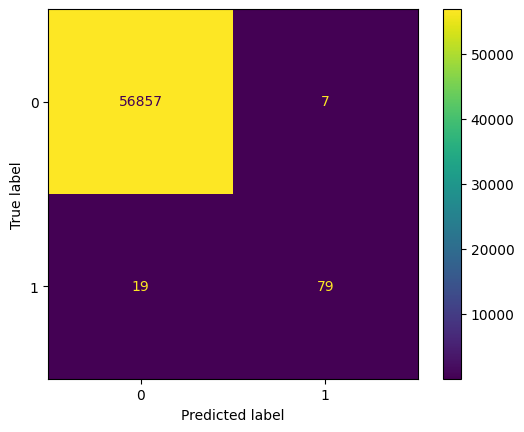

# **Detecção de fraudes de cartão de crédito**

https://www.kaggle.com/mlg-ulb/creditcardfraud/

---

# Objetivo

Dada uma compra efetuada com um cartão de crédito, identificar se é uma transação genuína ou uma fraude.

---

# Dados

Cerca de 280 mil transações anonimizadas realizadas por clientes Europeus em setembro de 2013, das quais 99,98% são genuínas e 0,02%, fraudes.

---

# Modelo

Foram criados dois modelos: 1) uma regressão logística e 2) um *gradient boosting*.

--- 

# Métrica

A métrica utilizada foi a precisão média (*average precision*), que é uma métrica apropriada para dados desbalanceados.

--- 

# Resultados

A regressão logística atingiu uma precisão média de 0.76, na validação cruzada, enquanto o *gradient boosting* atingiu 0.84. 

---

# Resultados (cont.)

Dada a performance superior do *gradient boosting*, foram utilizados os dados de teste para mensurar a sua generalização.

--- 

# Resultados (cont.)

Nos dados de teste, o modelo atingiu precisão média de 0.88. Também podemos ver a performance do modelo sumarizada por uma matriz de confusão.

--- 
# Conclusões

O modelo desenvolvido além de identificar grande parte dos casos de fraude, gera um número baixo de falsos positivos. Podemos, como próximo passo, testar outros thresholds, que possam ser mais apropriados para o modelo de negócio.