# **Detecção de fraudes de cartão de crédito**

https://www.kaggle.com/mlg-ulb/creditcardfraud/

---

# Objetivo

Dada uma compra efetuada com um cartão de crédito, identificar se essa transação é fraudulenta.

---

# Dados

Cerca de 280 mil transações realizadas por clientes Europeus em setembro de 2013, das quais 99,98% são genuínas e 0,02%, fraudes.

---

# Descobertas

Dados extremamente desbalanceados.

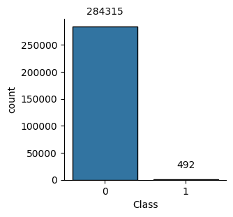

--- 

# Descobertas (cont.)

Distribuições por classe

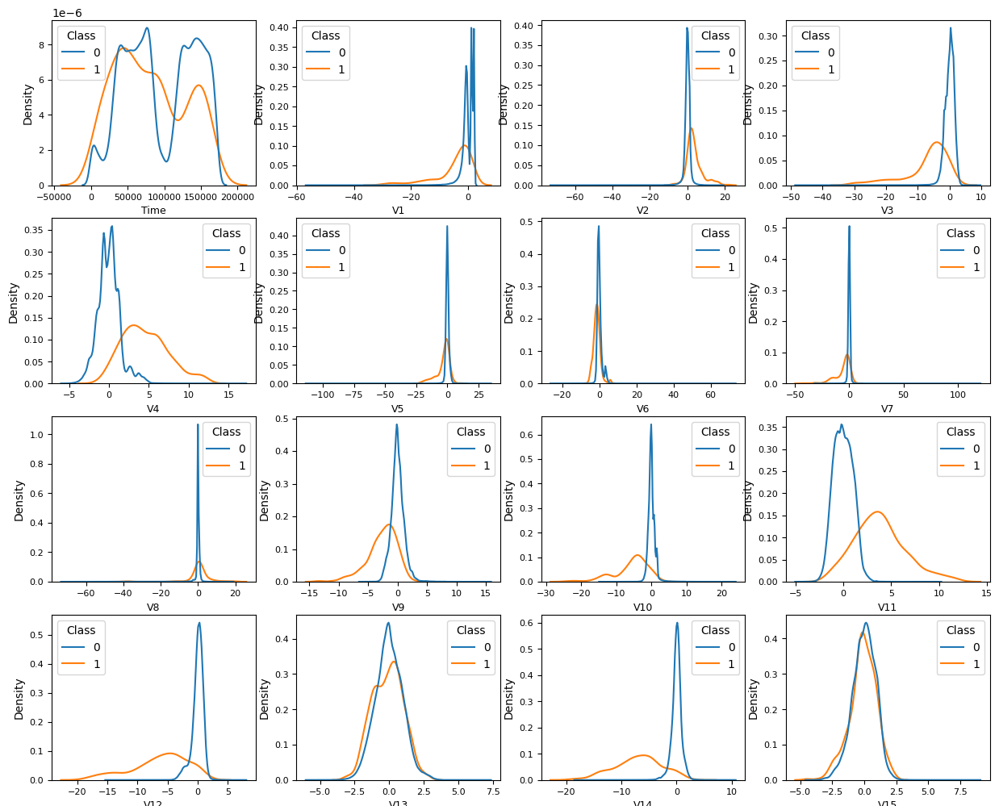 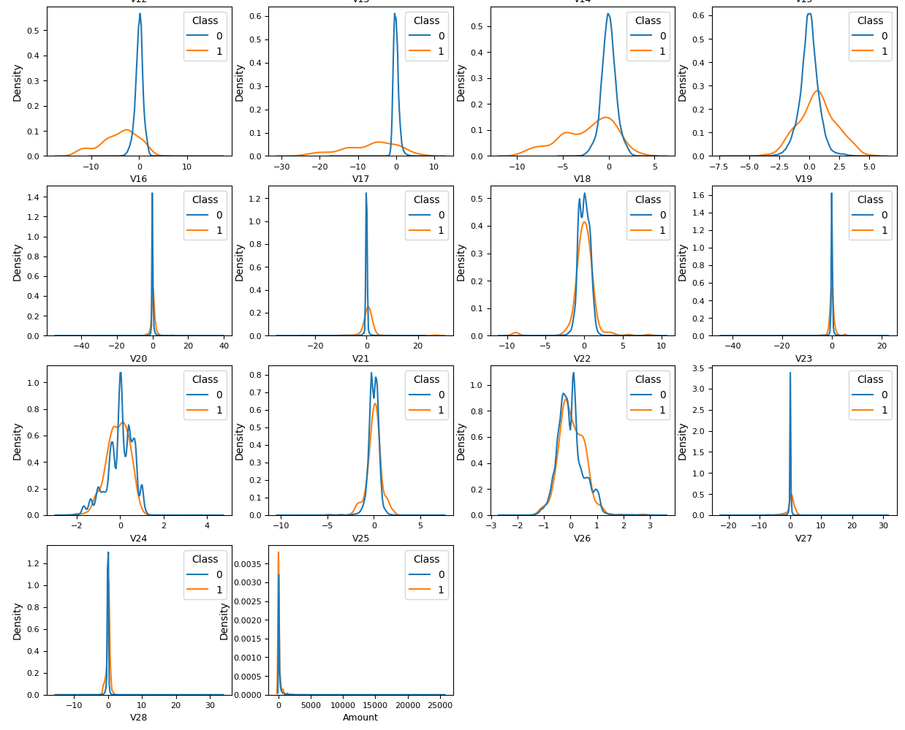

---

# Descobertas (cont.)

Distribuições por classe

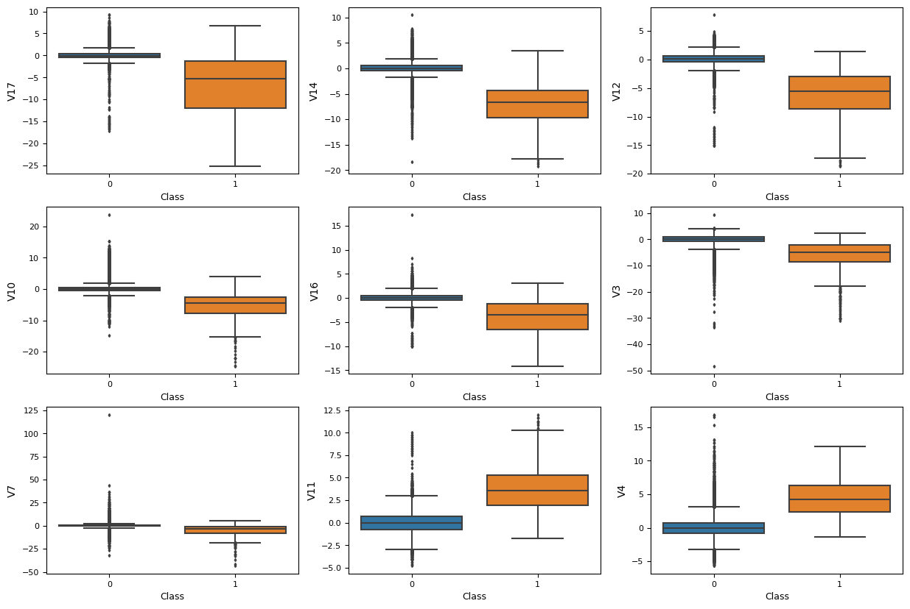

---

# Descobertas (cont.)

Correlações indicam que as variáveis $V_i$ realmente são componentes principais.

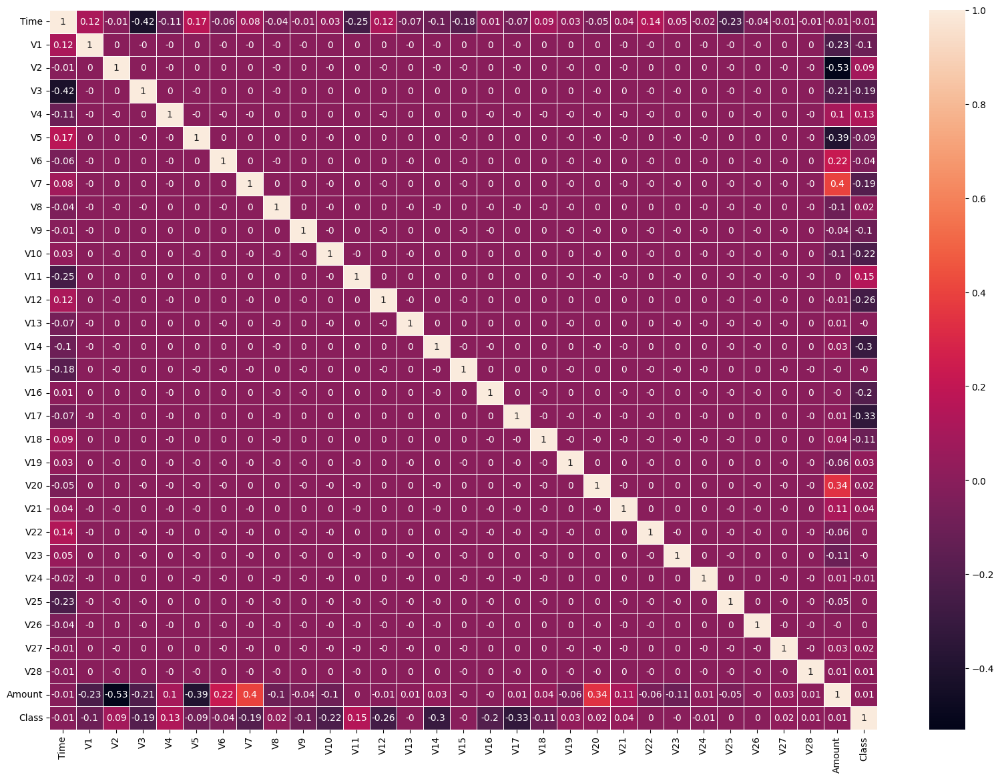

--- 

# Descobertas (cont.)

Correlações com o alvo

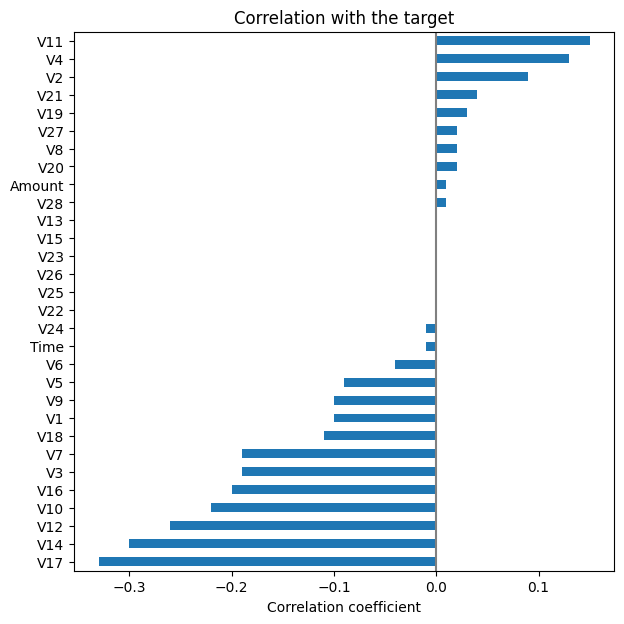

--- 

# Modelos

1) regressão logística e 2) *gradient boosting*.

---

# Métrica

Área sob a curva de precisão-revocação (AUC-PR).

--- 

# Resultados

A regressão logística atingiu uma AUC-PR de 0.72, enquanto o *gradient boosting* atingiu 0.85. 

---

# Resultados (cont.)

Coeficientes da regressão logística

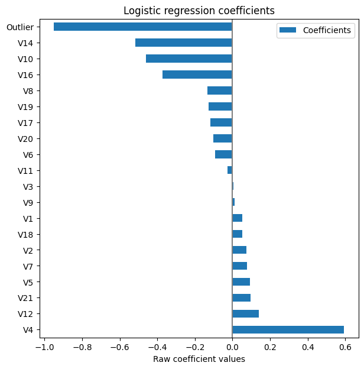

--- 

# Resultados (cont.)

Curva de precisão-revocação da regressão logística

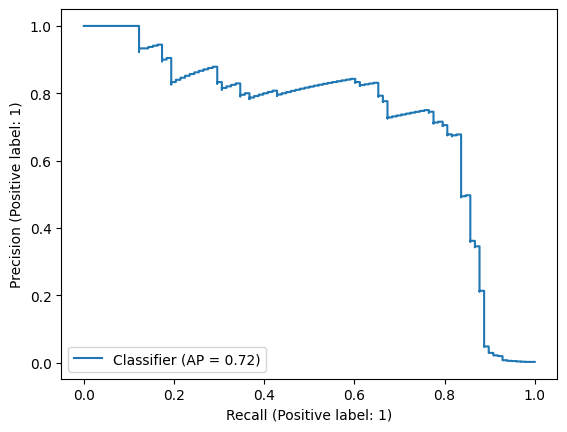

---

# Resultados (cont.)

Matriz de confusão da regressão logística


---

# Resultados (cont.)

Relatório de classificação

```
              precision    recall  f1-score   support

           0       1.00      1.00      1.00     56864
           1       0.80      0.65      0.72        98

    accuracy                           1.00     56962
   macro avg       0.90      0.83      0.86     56962
weighted avg       1.00      1.00      1.00     5696
```

---

# Resultados (cont.)

Importância das variáveis do *gradient boosting*

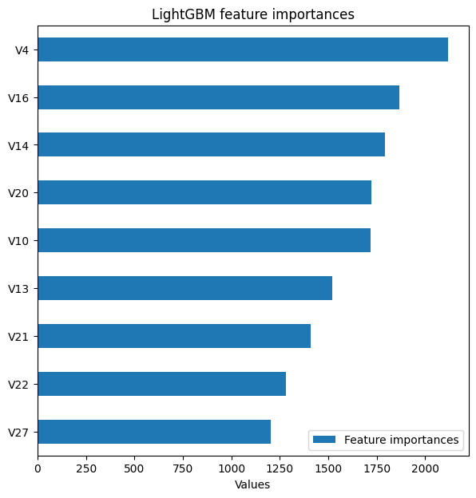

---

# Resultados (cont.)

Curva de precisão-revocação do *gradient boosting*

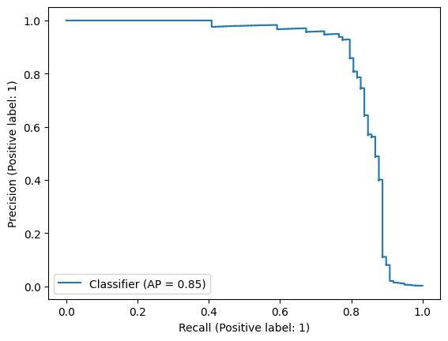

---

# Resultados (cont.)

Matriz de confusão do *gradient boosting*

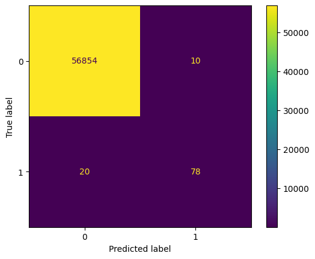

---

# Resultados (cont.)

Relatório de classificação

```
              precision    recall  f1-score   support

           0       1.00      1.00      1.00     56864
           1       0.89      0.80      0.84        98

    accuracy                           1.00     56962
   macro avg       0.94      0.90      0.92     56962
weighted avg       1.00      1.00      1.00     56962
```

---

# Conclusões

Dada a performance superior do *gradient boosting*, recomendamos o seu *deploy*.